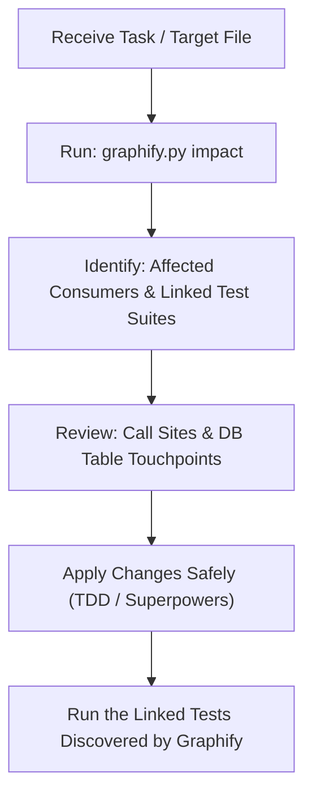

# Graphify (KASP Knowledge Graph & Impact Analyzer)

**Graphify** turns the KASP codebase, database schemas, and test suites into a queryable knowledge graph using deterministic AST analysis. It solves context loss and prevents breaking changes by computing exact impact radiuses and test associations before any code modification.

---

## 1. Capabilities

1. **Deterministic AST Parsing**: Traverses Python files (`kasp/`, root scripts, `test_*.py`) without sending code to external vector databases or spending LLM tokens.
2. **Impact Analysis (`impact`)**: Given a file or symbol, reveals:
   - All linked test suites that must be executed to verify safety.
   - All downstream modules and importers directly or indirectly affected.
3. **Call Graph Navigation (`callers`)**: Finds all call sites invoking a specific method or function across the entire project.
4. **Database-to-Code Mapping**: Tracks SQLite tables (from `kasp/data/database.py`) and maps which services/modules query or update each table.
5. **Test Mapping (`test-map`)**: Quickly identifies all unit/integration tests covering a specific KASP module.

---

## 2. Command Line Interface (CLI)

Agents in both **Antigravity** and **OpenCode** can execute the Graphify CLI tool directly:

```bash
# Rebuild / update knowledge graph snapshot (.graphify/graph.json)
python3 .agents/skills/graphify/scripts/graphify.py build

# Run impact analysis on a file or symbol before modifying it
python3 .agents/skills/graphify/scripts/graphify.py impact kasp/core/thermo.py
python3 .agents/skills/graphify/scripts/graphify.py impact calculate_compression

# Find all callers of a function or class
python3 .agents/skills/graphify/scripts/graphify.py callers get_connection

# Find test suites linked to a module
python3 .agents/skills/graphify/scripts/graphify.py test-map thermo

# View codebase graph metrics & table usage stats
python3 .agents/skills/graphify/scripts/graphify.py stats
```

---

## 3. Workflow for Coding Agents

Whenever tasked with modifying, refactoring, or debugging code in KASP:



1. **Pre-flight Check**: Run `python3 .agents/skills/graphify/scripts/graphify.py impact <file>` to map dependencies.
2. **Impact Boundary**: Check which downstream modules might break if signatures or return types change.
3. **Verification Target**: Use the list of linked test suites to run targeted tests (`pytest <linked_tests>`) rather than guessing which tests to run.
