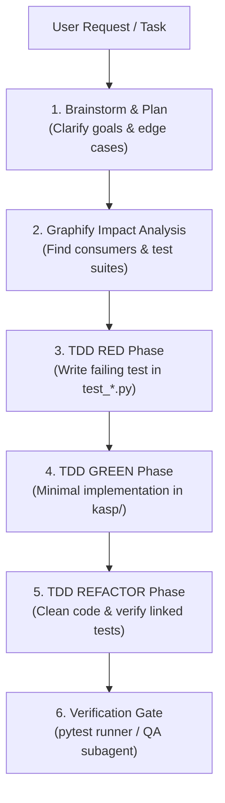

# Superpowers (Engineering Methodology & Discipline Framework)

**Superpowers** is an agentic engineering framework adapted from Jesse Vincent's (`obra/superpowers`) methodology. It transforms AI assistants from hasty code generators into disciplined senior software engineers.

---

## 1. Core Operating Principles

1. **Never Code Without a Plan**: For non-trivial tasks, align on requirements, identify edge cases, and write a structured execution plan before touching code.
2. **Strict Test-Driven Development (TDD)**:
   - **RED**: Write a failing test that clearly captures the bug or new feature.
   - **GREEN**: Write the minimal code necessary to make the test pass.
   - **REFACTOR**: Clean, optimize, and type-hint the code without altering behavior.
3. **Systematic 4-Phase Debugging**: No guessing. No random trial-and-error edits.
   - **Phase 1: Replicate & Observe**: Reproduce the issue with an exact command or minimal test.
   - **Phase 2: Isolate**: Pinpoint the precise line, function, or data condition causing the discrepancy.
   - **Phase 3: Hypothesize & Validate**: State the cause and write an assertion or unit test verifying the hypothesis.
   - **Phase 4: Targeted Fix**: Apply the narrowest fix that addresses the root cause, avoiding collateral damage.
4. **Impact Awareness via Graphify**: Always check `python3 .agents/skills/graphify/scripts/graphify.py impact <file>` to discover all consumers and linked test suites before refactoring.
5. **Quality Verification Gates**: Before completing any task, run the linked test suites and verify:
   - Thermodynamic calculation consistency.
   - UI internationalization (`tr()` in `kasp/i18n.py`).
   - SQLite schema backwards compatibility.
   - High contrast accessibility (WCAG AA).

---

## 2. Standard Workflow Cycle



---

## 3. Helper Tools & Commands

Agents can use the Superpowers TDD runner:

```bash
# Run specific tests linked to the task
python3 .agents/skills/superpowers/scripts/superpowers_tdd.py run test_thermo_limits.py test_p0_regressions.py

# Run quick smoke check
python3 .agents/skills/superpowers/scripts/superpowers_tdd.py quick-check

# Run full project test suite
python3 .agents/skills/superpowers/scripts/superpowers_tdd.py full-suite
```

---

## 4. Subagent Delegation Matrix

When working under OpenCode or Antigravity, delegate work according to domain boundaries:
- **Core thermodynamic / EOS / Aerodynamics**: `kasp-core-agent`
- **PyQt5 UI / Layouts / Themes / i18n**: `kasp-ui-agent`
- **SQLite / JSON / Reporting / Charts**: `kasp-data-agent`
- **Testing & Regressions**: `kasp-qa-agent`
- **Release / Packaging / CI**: `kasp-release-agent`
- **Impact & Knowledge Graph**: `kasp-graphify-agent` / `graphify` skill
- **Methodology & TDD Quality**: `kasp-superpowers-agent` / `superpowers` skill
